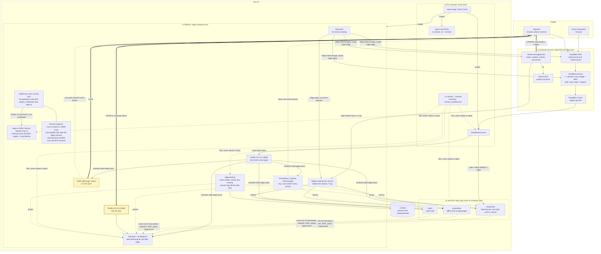

# Platform concept: from a bare PC to every service live behind the login (16.10.2026)

**Caller:** the operator, 16.10.2026:
- „nimm an ich muss es neu aufsetzen => welche Schritte muss ich wie machen? … was ein Script oder ein Tool machen kann soll es abnehmen … nichts doppelt und logisch getrennt … nach Ausführung sind dann all meine Dienste live hinter meiner Login-Seite und ich kann einfach User verwalten und Dienste an oder ausschalten“;
- „kann das nicht auch ein Script? zumindest durchleiten zu den Seiten?“;
- „all meine Tokens und Passwörter zentral verwaltet und auch checken, dass meine Seiten nur diese Keys haben“;
- „wie läuft das Deploy?“, then: „nicht einfach auf main, sondern wenn es ein Versions-Tag gibt … das den Deploy-Job triggert“;
- „Grafana sollte für die Plattform sein, also alle Dienste“ (ruled 16.10.2026).

**Read-only basis:**
- edge: README, `compose.yaml`, `keycloak/` (`master.yaml`, `realm.yaml`), `backup/`, `src/edge_backup/settings.py`, `systemd/`, CI;
- home-tools: README, `secrets_manifest.toml`, its file tree;
- songmaker: `scripts/auto-deploy.sh` and its system units, `docker-compose.yml`, `src/songmaker_cli/auth_api.py`;
- webauth: `src/webauth/oidc_login.py` (exists);
- presentator: `~/presentator-live` and its user units;
- hopin: README, Makefile, settings;
- issues edge#1, #4, #11, #13, #19 and home-tools#9, #10, #17, #21; hopin#25; presentator#196 and #197;
- the plan `ext-as-code.md` (OpenTofu, E3, its slices listed in the epic's body);
- live state: listeners, containers, timers, `/etc/cloudflared/config.yml`, `/etc/docker/daemon.json`, the operator's groups (`docker`, `sudo`), names in `~/.secrets` (names only), key names (not values) in the `.env` files.

No secret value was read. No write API was called.

**How to read it.** Each word in **bold caps** is one of the three places: **LOOK**, **PEOPLE**, **CHANGE**. "Today" means it exists and runs. "Planned" means a ruled plan or an open item. "Proposed" means this document proposes it and the operator decides (section 9).

---

## 1. The picture

> **The whole system on one page.** A solid box exists today. A dashed box is planned and not built yet. Thick arrows are the operator's three places: LOOK, PEOPLE and CHANGE.



**What the picture says, in six sentences:**
1. **The way in.** Every name ends in one tunnel. Cloudflare Access blocks every name that is not explicitly opened (`*` = operator only). Traefik on loopback hands each name to the container with that `edge.name` label.
2. **The login.** Keycloak at `auth.hallucinai.de` is the one login page. Every app checks the ID itself through webauth and its group `/apps/<name>`. songmaker joins only through its own cutover (section 3); until then it keeps its own login. Tools without their own login stay behind Access.
3. **PEOPLE.** People and their groups exist only in the Keycloak admin, `http://localhost:8090/admin/`, on this PC (later via Tailscale).
4. **CHANGE.** Every change is a pull request. A release (`edge release` sets a `v*` tag) is deployed by the service's watcher; whether the service is then reachable depends on its state (section 8 state table). The platform (edge) and the external services change when the operator runs `edge apply`.
5. **LOOK.** One traffic-light page answers "is it OK now?" for every service, the backup, the drift checks and the secrets. Grafana answers "why, and since when?" for every service. Both send alerts through one push channel to the phone.
6. **Agents.** Today agents run as the operator's user and can do whatever he can. Every "an agent may not" in this document is a request until D14 gives them their own user.

---

## 2. The layers

Each layer has **one** owner. The order is the order of a setup: a layer needs only the layers above it.

| Layer | Holds | One source of truth | Bring up | Check | Stays manual, and why |
|---|---|---|---|---|---|
| **L0 PC and tools** | Ubuntu packages (Docker with loopback default, cloudflared from apt, gh, uv, restic, the pinned `tofu`, Tailscale); `/etc/docker/daemon.json`; linger; auto-login off; the AppArmor profile; the agent user (only with D14); the `home` and `aco` tools; the work clones in `~/git` | home-tools: the setup playbook (home-tools#9; Ansible recommended there) | `~/git/home-tools/bootstrap` (new, home-tools#9), then `home setup --apply` (without `--apply`: dry run) | `home check` (daily timer, today) | OS install and disk encryption (the installer decides it); BIOS "power on after AC loss"; the first `gh auth login --web`, because cloning the private home-tools needs it |
| **L1 secrets** | every token, password and key; values only in `~/.secrets`; tool logins in their tools' stores. Directories 0700. Files 0600, except a file a container user must read: 0644 inside its 0700 directory (edge README, Keycloak). Today every agent can read all of it (D14) | `home-tools/src/home_tools/secrets_manifest.toml` (names, purpose, reader, scope, bindings, rotation; never a value) | `home secrets --setup`: walks every missing secret page by page (home-tools#10) | `home secrets`, part of `home check` (today: local view; the remote check is section 4) | creating a token at the provider: a human logs in and clicks. The wizard opens the page, takes the value hidden, verifies it, stores it |
| **L2 platform** | Traefik, socket proxy, Keycloak and its DB, step-ca (the internal CA for the MCP origins) and `traefik-mcp` (the second Traefik, the only container on the three internal networks `mcp-ca`, `mcp`, `mcp-backends`; no host port), edge-backup timers, the deploy watchers, the LOOK page (Gatus: "is it OK now?"), the monitoring stack for every service (Prometheus, Grafana, Alertmanager: "why, since when?"; moves out of songmaker, ruled 16.10.2026, edge#4), one alert channel | edge: `compose.yaml`, `traefik.yml`, `traefik-mcp.yml` and `mcp/dynamic/`, `keycloak/*.yaml` (realm as code), `step-ca/ca.json`, `backup/apps.toml`, `systemd/` | `edge apply --closed` (start without publishing), then `edge apply` (publish), then `edge start --all` (open the tunnel; section 6 step 11). Proposed: one command for compose, realm apply, timers, services on/off, external | `edge check` (proposed: `edge-check` today, plus readiness, backup freshness, deploy state) | the Keycloak go-live once (edge#19: the permanent admin with TOTP and passkey in the browser) |
| **L3 external** | Cloudflare DNS, Access apps and policies, tunnel ingress (D6); GitHub repo settings, rulesets, Actions policy, org secret names and reach | edge `fleet.yaml` + OpenTofu (`ext-as-code.md`, epic E3, its slices listed in the epic's body) | the publish phase of `edge apply` (operator, TTY, the word `yes`) | `edge external check` → `home check` | secret values, the tunnel object and its credential, Access identity providers, the Access group's one member, SonarCloud projects, CodeQL default setup, GitHub App installs, the registrar. Each has no provider or would put a secret into state |
| **L4 services** | songmaker, presentator, hopin, later the aco board | each service repo's `compose.yaml` (containers) + its entry in `fleet.yaml` (where it runs, who may use it, on or off) | the deploy watcher (newest `v*` tag) after `edge apply` turned the service on | the LOOK page (each service's health URL); Grafana for its metrics | creating a new repo's SonarCloud project (one click) |
| **L5 data** | Docker volumes (songmaker DB and audio, Keycloak DB; `step-ca` (README "Interne CA" names its backup) and `traefik-mcp-acme`, which is not: its certificates are issued again), the restic repository and its off-disk copy (D3), the encrypted OpenTofu state | edge `backup/apps.toml` | `edge-backup restore …` (section 6) | the restore test (monthly), the clean-machine drill (section 6), and the backup's freshness on the LOOK page | the restic password, the OpenTofu passphrase and the disk's recovery key live in the password manager: without them no backup, no state and no disk can be read |
| **People** | users, passkeys, group memberships (`/apps/<name>`, `/ki-abo`) | the Keycloak database (managed only in the admin console); the groups themselves are code in `keycloak/realm.yaml` | first-ever: create people in the admin console; re-setup: restore the Keycloak DB | Keycloak events (login anomalies) on the LOOK page | everything: people are never code (ruled) |

**Who calls whom (no step twice):**
- `home setup` installs the tools and clones edge. It creates the agent user only after D14 is ordered; until then the user is D14's step, not setup's. It installs cloudflared disabled and never starts a service.
- `home secrets --setup` creates secrets. Nothing else writes into `~/.secrets`, except `keycloak/go-live` for the three Keycloak service passwords (edge#19 rule 2), `step-ca/init` for `~/.secrets/step-ca/` (edge#38) and `edge-backup restore` on a re-setup.
- `edge apply` is **the one publisher**. `edge apply --closed` runs only the local part: the platform and the enabled services. `edge apply` without `--closed` runs the local part, then its publish phase: `edge external apply` and its check of each host against the catalog. It never creates a secret: when a service's setup is missing it asks **separately** ("step-ca has no keys yet. Create them now? (yes)") and then delegates to the existing owner, `step-ca/init` or `keycloak/go-live`, which keep the key generation, and the operator runs `edge apply` himself. For `--closed` this is built ([edge#69](https://github.com/overnightworks/edge/issues/69)): the question comes before the plan, the setup runs in the operator's terminal with its output uncaptured, `--check` runs again, and a fresh plan follows with its own `yes` (R2, ruled 16.10.2026, [edge#50](https://github.com/overnightworks/edge/issues/50)). `keycloak/go-live` never publishes.
- The deploy watcher deploys newer tags and nothing else.
- What `edge apply`, `edge start` and the watcher may do in each state: section 8 state table.
- `home check` only reads. It runs every checker: tidy, secrets, edge-check, external drift.

### The agent service (A1d) in the layers

The agent service is an L4 service: the one place that holds the subscription logins and runs the provider CLIs for every app ([agent-providers#18](https://github.com/overnightworks/agent-providers/issues/18)). It sits behind Keycloak (its client `agent-service`), reaches MCP servers only over https through `traefik-mcp` (edge#37 slice 2), and trusts the internal CA's root (section 4). Six rulings of 16.10.2026 shape it. The library contract stays owned by agent-providers; each line here only states the ruling and links its owner.

1. **Closed environment.** Every CLI child is started by the library's one spawn owner with an explicit environment, an absolute binary and an explicit cwd, and inherits nothing from the host ([agent-providers#10](https://github.com/overnightworks/agent-providers/issues/10)).
2. **One private root.** Everything a child may write lives below the host's `cli_working_directory_root` (0700): the private credential homes, `TMPDIR` and the Codex sandbox directories; the library owns the layout below the root and the host owns the root ([agent-providers#10](https://github.com/overnightworks/agent-providers/issues/10), [agent-providers#49](https://github.com/overnightworks/agent-providers/issues/49); the host's owner of the root is Songmaker, [songmaker#1476](https://github.com/overnightworks/songmaker/issues/1476)).
3. **Sandbox policy from that root.** The host derives its AppArmor profile and Bubblewrap mounts from the root and allows writes only below it, for songmaker today and for the agent-service container in A1d, because a closed environment is not access control and hiding the operator's real `~/.claude` is a deployment matter of one volume per profile ([agent-providers#10](https://github.com/overnightworks/agent-providers/issues/10), [agent-providers#18](https://github.com/overnightworks/agent-providers/issues/18)).
4. **MCP origins: https only, with step-ca** ([edge#37](https://github.com/overnightworks/edge/issues/37), option d).
5. **No provider text in logs.** Provider text never reaches a service or library log or an exception chain; the host receives a sealed excerpt and alone decides whether to write it down ([agent-providers#9](https://github.com/overnightworks/agent-providers/issues/9), [agent-providers#56](https://github.com/overnightworks/agent-providers/issues/56), [agent-providers#68](https://github.com/overnightworks/agent-providers/issues/68)).
6. **The library defines its contract, hosts adapt to it** ([agent-providers#49](https://github.com/overnightworks/agent-providers/issues/49)).

**What this means for the platform (A1d):**
- The container mounts only its profile volumes and its `cli_working_directory_root` (section 4).
- Its AppArmor/Bubblewrap policy permits writes only below that root.
- Its egress covers the registered MCP origins, LiteLLM and the provider endpoints the Claude CLI calls directly.

---

## 3. The service catalog

### One file, one entry per repository

The catalog is **`fleet.yaml`**, the manifest that epic E3 already plans for OpenTofu. A second catalog would duplicate the repo list and the host names. E3 is not built yet (X1 has not started), so this costs nothing now.

**Four changes to the E3 plan** (made once, when E3 is opened):
- **Location.** `fleet.yaml` moves from `external/` to the edge root, because L2 (deploy, LOOK) reads it too. OpenTofu reads `../fleet.yaml`.
- **A `run` block** on the entries that run on this PC. A library such as webauth has no `run` block, only `repo`.
- **Entries, not repositories, are the unit** (P1, P2, P14, ruled in [edge#50](https://github.com/overnightworks/edge/issues/50)). Platform units are entries keyed by their compose profile (`step-ca`, `keycloak`; socket-proxy and traefik are the always-on core), and repositories are entries with `repo`. One repository can carry several switchable units. `src/edge/catalog.py` owns the typed `run` schema (`enabled`, `setup`); `run.setup` names the key command behind its `--check` contract (edge#52 rule 8). Images, volumes and ports are never repeated in the catalog. `docs/naming.md` records that catalog keys equal compose profile names (P5).
- **The tunnel mode is decided once, by D6 here**. It replaces E3's D5. E3 recommends remote management; this concept had assumed the local JSON credential. D6 now names both the mode and the credential form, so X6 builds one.
- **X8: go-live does not publish**. E3's X8 makes `keycloak/go-live` step 8 call `edge external apply`. That would publish inside the go-live, before the re-setup's later publish step (section 6, step 11). Changed: go-live ends unpublished; the publish phase of `edge apply` is the only publisher. X8's "apply refuses while `auth` does not answer" stays, now inside `edge apply`. Until `edge apply` exists, the operator runs `edge external apply` by hand after go-live, as one named step.

```yaml
services:
  hopin:
    repo: {visibility: public, default_branch: master}   # GitHub settings (E3, X2)
    run:
      enabled: true              # Dienst an/aus: the one switch
      login_group: /apps/hopin   # must exist in keycloak/realm.yaml; CI checks it
      health: /health            # the LOOK page polls it through Traefik
      deploy: tags               # follow the newest v* tag (section 5)
      # setup: step-ca/init      # only where a unit needs key material (step-ca, keycloak)
    hosts:
      - name: hopin              # hopin.hallucinai.de → container labelled edge.name=hopin
        exposure: bypass         # public, own login; the * Access app would otherwise cover it
        reason: "video calls; starting a call needs a login (hopin#25)"
```

### What the catalog drives, and what it must not duplicate

| Fact | Owner | The catalog… |
|---|---|---|
| Containers, images, ports, volumes, the `edge.name` label | the service repo's `compose.yaml` | names only the host. `edge check` reports an enabled host without a running container that carries its `edge.name`, a running `edge.name` that no enabled host lists, and a long-running service container whose restart policy is not `unless-stopped` (section 8: switches must survive a reboot). One-shot jobs are declared `jobs = [...]` in the entry (songmaker: `migrate`, `restart: "no"`) and are exempt |
| Keycloak groups | `keycloak/realm.yaml` | references `login_group`. A CI check in edge fails when a `login_group` is missing from `realm.yaml`, or when an `/apps/*` group has no entry |
| What to back up | `backup/apps.toml` | says nothing. A CI check fails when an `apps.toml` app has no catalog entry |
| DNS, Access app, tunnel line, repo settings | the catalog itself (rendered by OpenTofu) | is the owner |
| The LOOK page's service lights, Prometheus's scrape targets | the catalog | `edge apply` renders the Gatus endpoint list and the scrape list from the enabled entries |
| The deploy watchers | the catalog | `edge apply` installs one watcher per enabled entry with `deploy: tags` |
| The release branch | the catalog (`repo.default_branch`) | `edge release` tags that branch; hopin's is `master` |

**Why the catalog does not generate `realm.yaml`.** keycloak-config-cli manages groups "in full": a group missing from the YAML is deleted **with every membership in it** (edge README, Keycloak section). If the catalog generated the groups, switching a service off would delete its people's memberships. So `realm.yaml` stays the group owner. Switching off never touches a group. Deleting a group is its own deliberate pull request.

### "Dienst an/aus" end to end

**Off** (example: hopin):
1. **CHANGE.** The operator, or an agent on his word, opens a PR in edge: `enabled: false`. CI checks the catalog rules. He merges.
2. **He runs `edge apply`.** It shows the plan and asks for `yes`:
   - hopin's watcher is removed;
   - hopin's services are stopped and removed, exactly the services the unit resolves to (P13, [edge#50](https://github.com/overnightworks/edge/issues/50)): never a project-wide `down`, which would also take shared services such as Traefik, and never `--volumes`, so the named volumes stay;
   - the LOOK page drops its light, Prometheus drops its target;
   - `edge external apply`: the DNS record, Access app and tunnel line go.
3. **Result (R1, ruled 16.10.2026, [edge#50](https://github.com/overnightworks/edge/issues/50)).** "Off" removes a service's containers and never its volumes, data mounts or keys; "on" again uses the same identity and data. `edge apply` never deletes a volume; removing one stays a manual command. hopin is in state E (section 8 state table): closed as soon as its container is gone, before the external part finishes.

**On:**
1. A PR sets `enabled: true`. He merges and runs `edge apply`.
2. `edge apply` clones hopin into `~/srv/hopin`, checks out its newest `v*` tag, starts it and waits for `/health`.
3. The publish phase then publishes the name, behind its `ready` guard (X8's "protection before reachability"). hopin is in A, or in C under a global stop (section 8 state table).

**The realm apply (R3, ruled 16.10.2026, [edge#50](https://github.com/overnightworks/edge/issues/50))** runs inside `edge apply` under four conditions:
- it reconciles for real, not with a checksum-cached skip;
- every concrete deletion is shown first;
- deletions need a **separate** confirmation;
- a restorable realm export is taken before any deletion.

**Today's switch** is different: "off" means removing a tunnel line by hand, as on 14.10.2026 for presentator.

**Emergency switches are separate:** `edge stop hopin` takes it offline at once without a code change. Guards: section 8 state table.

### Hopin as the worked example: what it needs before its entry works

- **hopin#25 first:** login through webauth (`/apps/hopin`), Impressum and Datenschutz.
- **A `compose.yaml` and a Dockerfile** with `edge.name: hopin`, `restart: unless-stopped` and **no published port**. Today hopin has neither and runs `uv run hopin` on port 8080, which songmaker already uses. Traefik reaches the container by its bridge IP, so no host port is needed.
- **Its first release:** `edge release hopin` tags the green tip of `master`.
- **The catalog entry above;** then `edge apply`.
- **Its SonarCloud project** already exists: hopin has `sonar-project.properties`.

### songmaker: from its own login to the one login

**Today songmaker signs people in itself.** It uses webauth's password login (`src/songmaker_cli/auth_api.py`: setup, login, password change). Its users and password hashes live in songmaker's own database. `realm.yaml` has no songmaker client: its only client is `agent-service`. So deploying songmaker behind the platform changes nothing for its users. D4 ("Keycloak for every app user") needs a cutover of its own.

**The cutover item** (songmaker; neighbours edge#19 and webauth; after go-live):
1. **Client.** edge adds a `songmaker` client to `realm.yaml`, with its redirect URI on `hallucinai.de`. Its secret goes into `~/.secrets/keycloak/` and the manifest.
2. **Login.** songmaker switches to webauth's OIDC login (`webauth/src/webauth/oidc_login.py` exists) and checks the group `/apps/songmaker`.
3. **Accounts.** Each songmaker user row gains the Keycloak user ID beside its own ID. Songs and albums stay keyed by songmaker's own ID, so no data moves. The operator first creates each person in Keycloak. A one-time mapping then pairs the two by username. He confirms each pair; nothing is matched silently. The admin role comes from a Keycloak group; the exact rule is a line in the item's expectation list.
4. **Retire the old login.** After every user has signed in once through Keycloak, the password form goes and the stored password hashes are deleted (deletion: spoken yes).

**Done when:**
- the mapping ran first on a restored copy of songmaker's data, with the same result;
- every existing songmaker user signs in through `auth.hallucinai.de` and sees their own songs;
- a person without `/apps/songmaker` is refused;
- the old password login answers 404.

---

## 4. The secret inventory and its check

### One inventory

`secrets_manifest.toml` (home-tools) stays the one inventory. Values stay in `~/.secrets`. It gains five fields per entry:

| Field | Meaning | Example |
|---|---|---|
| `purpose` | one sentence: what breaks without it | "SonarCloud analysis in CI" |
| `scope` | the permissions it was created with, as declared | `["sonarcloud:analyze"]`; `["org:secrets:read", "repo:metadata:read"]` |
| `bound_as` | exactly where each app receives it: a compose secret file, or a named environment variable | `{app = "edge", file = "keycloak/db-password"}`; `{app = "presentator", env = "PRESENTATOR_SECRET_KEY"}` |
| `placed_at` | where a copy lives at a provider, by name | `github-org-secret:SONAR_TOKEN` |
| `max_age_days` | rotation rule (home-tools#10 line 15: a date only with provenance) | `365` |

Each app also gets one list of **plain keys**: the `.env` and `environment:` keys that are configuration, not secrets (example: `POSTGRES_USER`). Every key an app reads is then either a declared binding or a declared plain key. Nothing is judged by its name.

Today's fields stay: `name`, `kind`, `paths`, `read_by` (= consumer), `recreate`, `verify`, `retired_on`.

**The internal CA's files (edge#38).** `step-ca/init` creates them once; the manifest entry belongs to home-tools#21.

| File | Mode | Who reads it | In the backup |
|---|---|---|---|
| `~/.secrets/step-ca/root_ca_key` | 0600 | only `step-ca/init`, in a one-off container without a network; never mounted into the running CA | planned (Block 9) |
| `~/.secrets/step-ca/root_ca.crt` | 0644 | `traefik-mcp` (uid 65534, as the compose secret `step_ca_root_certificate`) and the agent service as the trusted root | planned (Block 9) |
| `~/.secrets/step-ca/password` | 0644 in the 0700 directory | the CA, through `/run/secrets/step_ca_password`; it protects the root and the intermediate key alike | planned (Block 9) |
| volume `step-ca`: `certs/`, `secrets/intermediate_ca_key`, `db/` | uid 1000 | the CA | planned (Block 9) |
| volume `traefik-mcp-acme`: `acme.json` (the issued certificates and their keys) | uid 65534 | `traefik-mcp` | no: they are issued again |

**The agent service's volumes (A1d).** Its container mounts two things and nothing else from the host; the rulings are in section 2.

| Mount | Holds | Mode | In the backup |
|---|---|---|---|
| one volume per profile | that profile's subscription login | the container user only; no other profile and not the operator's `~/.claude` | no: the login is restored from its `~/.secrets` source ([agent-providers#18](https://github.com/overnightworks/agent-providers/issues/18)) |
| `cli_working_directory_root` | the private credential homes, `TMPDIR`, the Codex sandbox directories | 0700, owned by the host; the library owns the layout below it | no: rebuilt on start |

**One split keeps it single.** The manifest owns *what a secret is and where an app receives it*. `fleet.yaml` owns *where GitHub installs it and which repos see it*: the org secret name and its reach (E3, X5). The value is set by `home secrets --rotate` (home-tools#10 line 19). Its reach is checked by `edge external check`. home-tools#10 line 19's own "repo list drift" view is therefore dropped; the reach check lives once, in X5.

### The check: `home check` compares the inventory with reality

| Finding | Meaning |
|---|---|
| `missing` | the manifest names it, reality lacks it |
| `extra` / `undeclared` | reality has it, the manifest does not name it (for app keys: neither a binding nor a plain key) |
| `over-privileged` | reality grants more than `scope` declares |
| `stale` | older than `max_age_days`, expiring within 30 days, or unused for 90 days |
| `unverified` | the check cannot prove the deployed value equals the central one, and says so |

Every finding names the subject and a page to fix it, never a value.

**What the check can prove, and what not.**
- **A compose secret file is `bound_as`** when the container's mount source is exactly the declared `~/.secrets` path. That proves the central file is what the container gets, not that the app reads it: **consumption stays `unverified`** unless the app exposes a check (a health field naming the secret's fingerprint, never its value). The check reads only the mount path (`docker inspect` `.Mounts`), never the file.
- **An inline literal in compose is a finding.** It is reported by key name only, value redacted, and never printed or logged.
- **An environment variable is `unverified`,** always. Its value comes from a `.env` file or the shell. Metadata cannot show it equals `~/.secrets`. The fix is to move it to a compose secret file (gap row 21); then it becomes `bound`.
- **A copy at a provider is `unverified`,** always (GitHub org secrets, Actions secrets). GitHub shows only `updated_at`. The check shows that date beside the local file's date, as a hint, never as proof.

**Safe extraction, so no value is ever printed:**
- compose: the file is parsed by the check's own YAML reader, which keeps `secrets:` paths and `environment:` key names and drops every value at once. `docker compose config` is never run, with or without `--no-interpolate`: those flags stop variable resolution, they do not redact literals written in the file.
- `.env` files: a parser that keeps each key and drops its value at once.
- containers: `docker inspect` mount sources only; never `.Config.Env`, which holds values.

| Source | What can be read, read-only | Credential needed | Findings |
|---|---|---|---|
| **`~/.secrets` on disk** | names, modes (`stat` only; today) | none | missing, extra (today: `unknown-file`), loose mode (0600; 0644 only where `bound_as` names a container file, inside a 0700 directory) |
| **App secrets in compose** | the safe extraction above, for every enabled service: `secrets:` file paths, `environment:` keys, `.env` keys in the deploy checkout, mount sources | none | `bound_as`, `unverified`, `undeclared`, `missing`, `inline-literal` (key name only). **Today every key in songmaker's and presentator's `.env` is `undeclared`,** because the manifest declares none. Among them are 8 secrets: songmaker's `SESSION_SECRET`, `POSTGRES_PASSWORD`, `ADMIN_PASSWORD`, `GRAFANA_PASSWORD`, `HF_TOKEN`, `SMTP_PASSWORD`, `SONGMAKER_INTERNAL_TOKEN`, and presentator's `PRESENTATOR_SECRET_KEY`. A name rule (`*PASSWORD`, `*SECRET`, `*TOKEN`) would have missed the last one |
| **GitHub org Actions and Dependabot secrets** | `GET /orgs/{org}/actions/secrets` and `/dependabot/secrets`: names, `visibility`, `updated_at`; `…/{name}/repositories`. Repo secrets: `GET /repos/{o}/{r}/actions/secrets`. **Never values** | fine-grained read token: org Secrets read, Dependabot secrets read, repo Secrets read, Metadata (E3's `github/fleet-read`) | extra (presentator's repo `SONAR_TOKEN` beside the org secret, ext G5); over-privileged (visibility wider than declared); stale (`updated_at` is a dated rotation with provenance); equality always `unverified` |
| **GitHub tokens themselves** | a fine-grained PAT's expiry: the response header `github-authentication-token-expiration` of any call made with it. A classic token's scopes: the `X-OAuth-Scopes` header | the token itself | stale (expiry); over-privileged against `scope`. The `gh` login keeps `admin:org` until E3's D6 (removing `admin:org`) removes it after X3c (kept on purpose for edge#29); its live scopes are read from the `X-OAuth-Scopes` header of `gh api -i user`. Listing *all* tokens with org access needs a GitHub App (`GET /orgs/{org}/personal-access-tokens`); a PAT cannot, so "extra tokens" stays a yearly glance at the settings page, unless D8 adds the App |
| **SonarCloud** | `GET api/user_tokens/search`: token names, `createdAt`, `lastConnectionDate`, `expirationDate`; `api/projects/search?organization=overnightworks` | a SonarCloud user token (read; verify which permission the project search needs when building) | extra and unused tokens; a repo with `sonar-project.properties` but no project |
| **Cloudflare API tokens** | each token verifies itself: `GET /user/tokens/verify` (or `/accounts/{id}/tokens/verify`) returns status and `expires_on`. A list of all tokens needs the permission "API Tokens Read" | the token itself; for the full list, one more read permission (D8) | stale, expiring; extra only with the list permission |
| **Cloudflare tunnels and Access service tokens** | `GET /accounts/{id}/cfd_tunnel`; `GET /accounts/{id}/access/service_tokens` (names, `expires_at`) | `cloudflare/fleet-read` plus Tunnel read and Service Tokens read | extra tunnel (a second live tunnel is an open door); expiring service token |
| **Keycloak clients** | the client list, which clients are confidential, their redirect URIs. `realm.yaml` already deletes undeclared clients at every apply, so drift appears only between applies | a **read-only** service account in `hallucinai` with `view-clients` and `view-realm`. It cannot change anything and is not an admin credential (D8) | extra client; a confidential client whose secret file is missing in `~/.secrets` |

**The checks stay narrow.** Each source is one small reader returning findings in edge-check's shape. GitHub and Cloudflare already come from `edge external check` (X5); only the token self-checks, SonarCloud, the compose scan and Keycloak are new. `home check` aggregates them, with notify-on-change as today.

---

## 5. Deploy: a version tag triggers it

### The model, the same for every service

| Branch or tag | Role |
|---|---|
| the default branch (`main`; hopin: `master`) | the always-green integration branch; a landing never deploys by itself |
| `v*` tag | a release. It is immutable: org ruleset 25224012 "release tags are immutable" blocks deletion, update and force-push of `refs/tags/v*` in every repo (checked 16.10.2026) |

**What each deploy watcher does** (one per service, a systemd timer every 2 minutes):
1. **Find the newest release.** It fetches tags and takes the newest `v*` tag whose commit is on `origin/<default branch>` and that is not in the skip list (see rollback). Guards: section 8 state table.
2. **Gate it.** songmaker's gate, carried over as it is and named (`auto-deploy.sh` from line 147):
   - only check runs from GitHub Actions count;
   - every Actions job must end `success`, `skipped` or `neutral`, and at least one must end `success`;
   - the job `SonarCloud scan` is advisory: its result never blocks a deploy.
   `edge release` uses the same rule, so "green" means one thing.
3. **Back up first if the schema changes.** If the tag's database schema differs from the running one (see rollback), the watcher runs the app's backup before it deploys. That backup is the way back.
4. **Deploy it.** It accepts only a tag from step 1 (see "What a deploy accepts"). `git checkout --detach <tag>` in the deploy checkout `~/srv/<name>`, then `docker compose build`, then a busy check (songmaker: no running job), then `docker compose up -d --wait`. songmaker's `migrate` service runs `alembic upgrade head` as part of this (`docker-compose.yml` line 49).
5. **Book it.** After `--wait` succeeds it reads the live database's schema version and compares it with the tag's `schema:`. Only an equal version writes the deployed tag to its state; songmaker's `deployed.sha` rule carries over as `deployed.tag`. A migration that succeeded but a health check or schema comparison that failed leaves the state `migrated, not healthy` with the live schema recorded, never the old tag; the LOOK page shows it red. The state is backed up, so a re-setup knows which version wrote the data.
6. **Alert.** After 3 failed ticks in a row, the LOOK page turns red and an alert goes out (songmaker's counters, unchanged).

**What a deploy accepts, and who may write it (D14).**
- **Only a release tag.** The deploy input is a `v*` tag fetched from the forge (step 1), protected by ruleset 25224012. Never a local working tree, branch or path.
- **Root-owned, not agent-writable:** the `edge` CLI and the `home check` executable (installed by `home setup` under `/usr/local`), the watcher units, and the deployment checkouts (`~/srv/<name>`, songmaker's auto-deploy checkout, the live edge checkout). The agent user cannot write them. Agents work in their own worktrees and reach a deploy only through a pushed, gated tag.
- **The proof:** `home check` fails when any path on a deploy path (those executables, units, checkouts and the paths the watchers read) is writable by the agent user or by a group it is in.

**The watcher's GitHub credential** becomes a read-only token: Contents read and Checks read on the service repos (`github/deploy-read` in the manifest). Today songmaker's watcher calls `gh api`, so it runs with the operator's `gh` login (`repo`, `workflow`). A read token is needed at all because three watchers polling every 2 minutes make 90 calls an hour, above the 60 an unauthenticated client gets.

**Rollback: only when the old code fits the data.**
- **Why a rule.** songmaker migrates its database on every deploy. Code from the tag before may not understand the new schema. A blind rollback can break the app or the data.
- **The schema is declared.** `edge release` writes the schema into the annotated tag message: `schema: <alembic head>`, or `schema: none` for a service without a database, and optionally `schema-min: <head>` for the oldest schema this code still reads. The compatibility evidence for a rollback is the live database's version (read as in step 5, not taken from the state file) lying between the target tag's `schema-min` (default: its `schema`) and its `schema`.
- **`edge rollback hopin`** deploys the tag before the current one only when that tag's declared schema fits the live database. It writes the bad tag into the skip list, `skipped` in `~/.local/state/edge/<service>.toml` (the watcher's state file). The watcher never deploys a skipped tag; it follows the newest tag that is not skipped. A newer tag deploys normally, and the entry stays until the operator removes it with `edge unskip <service> <tag>`. `edge restore` writes the same entry (below). While a skip is active, the LOOK page shows hopin yellow with "rolled back to vX, vY skipped".
- **When the live schema is outside that range, it refuses.** It says: "vY changed the database. Stop the service (`edge stop hopin`) and ask the operator." The way back is then `edge restore hopin --tag vX`. It restores the backup the watcher took before vY (step 3), then deploys the chosen tag, which must be schema-compatible with that data (the same range check as above). It writes the bad tag into the same skip list; a newer tag is still picked up. The full walk is the incident table's row "A bad release" (section 8).
- This is a kill switch (ruling 12), not a change: the tags stay as they are.
- In which states rollback and restore may run, and when the service opens again: section 8 state table. Who may run them: section 8's command table.

### Who sets the tag, and when

**The release step is the head's, delegated like webauth's releases today.** webauth tags `v*` and never moves a tag: a broken release gets the next patch tag. It cut v0.12.0 and v0.13.0 on 15.10.2026. The operator never tags by hand.

**Why not tag every landing.** songmaker had 95 first-parent commits on main in the last 14 days, about 7 a day. One tag per landing would be main-deploy under another name. One release step per landing would add 95 extra agent dispatches.

**The rhythm (proposed default, D5):**
- **One batch release per service per working session,** after the last landing of a session, or when the operator asks ("release songmaker"). That is about 1–2 a day for songmaker, against 7 landings.
- **A fix for something broken in production** gets its own release right after its landing.
- **One release implementation, not one per repo: `edge release <service>`.** It reads the service's repo and default branch from the catalog. It refuses unless that branch's tip passes the gate above. It picks the next version, writes the PR titles since the last tag and the `schema:` line into an annotated tag on that tip, and pushes it. The head runs it as a mechanical step (the cheapest routing row, low effort); no review, because the tag adds no code.
- **Version form for services:** `vYYYY.MM.DD.N` (example `v2026.10.16.1`). A service has no API consumers who need SemVer, and a date says at a glance how old the running version is. Libraries such as webauth keep SemVer and their own release. Both match `v*`.
- **aco's landing brief names the freed release.** "Landed, not released" is visible on the LOOK page as "the default branch is N landings ahead of the running tag", so nothing waits silently.

### What stays applied by the operator

- **edge itself** (L2): `edge apply` after his merge. It fast-forwards edge's live checkout, shows the plan and asks `yes`. Changing the gatekeeper, Keycloak or the backup is never automatic.
- **External** (L3): the publish phase of `edge apply`. Only the operator holds the write tokens (E3 rule 3).
- **Why not automatic.** Agents run as his user today, so any token on a timer would be an admin credential in an agent's reach. Automatic apply becomes possible only after D14.

### How each service joins

| Service | Today | Joins by |
|---|---|---|
| **songmaker** | system timer `songmaker-autodeploy.timer` (every 2 min) runs the 1,253-line `scripts/auto-deploy.sh` on `~/git/songmaker`, following `origin/main` once CI is green. The checkout is also the place `aco land` must not run (memory: land from `~/git/songmaker-land`) | the migration below |
| **presentator** | manual. `~/presentator-live` is a separate checkout at `1f0422c` and runs a locally built image (`presentator-adoption-instance:ap112-e04e837a`) on 127.0.0.1:8100. Two host user units run from that checkout: `presentator-speech` and `presentator-copresenter`; speech is crash-looping (stale socket file, seen 16.10.2026). Offline publicly since 14.10.2026 | its go-public item #197 adds a catalog entry with `deploy: tags`, its first `edge release`, and a watcher that also restarts its two host units after the compose deploy |
| **hopin** | not deployed; no container | section 3's example: a compose file, then its first tag |

### Migrating songmaker off main-deploy

1. **The first tag.** The head tags the commit in songmaker's `deployed.sha` as `v2026.MM.DD.1`, with its `schema:` line, so the switch deploys nothing new.
2. **Its watcher follows tags.** In `scripts/auto-deploy.sh`, the deploy target changes from "newest green commit on `origin/main`" to "newest green `v*` tag on `main`". Everything else stays: the gate, busy check, base-image rebuild, Prometheus reload, the counters, the alert. It gains the backup before a schema change. This is a songmaker item; its tests already pin the script.
3. **A deploy checkout of its own.** `~/srv/songmaker`, cloned fresh. The `.env` moves with it (later: its secrets move to `~/.secrets/songmaker/`, section 7). `install-autodeploy.sh` points the unit there.
4. **`~/git/songmaker` becomes a plain work clone again.** `aco land` there is harmless, `~/git/songmaker-land` can go, and the memory note about it is retired.
5. **Later, once presentator needs a watcher.** The tag watcher moves from songmaker into edge as the one generic `edge-deploy@<service>` unit. songmaker keeps its busy check as its own health URL (`/deploy/ready` answers whether a job runs). Building the generic watcher before a second service needs it would be building for an imagined caller.

### On a re-setup

Section 6 step 8 starts every enabled service at the tag its backup recorded; from there the watchers above take over (when they run: section 8 state table). There is no separate "install-autodeploy" per repo.

---

## 6. The re-setup runbook: from a bare PC to every service live

Every step is either **one command** or a **guided step**. A guided step means the tool:
1. says in one sentence what happens and why;
2. opens the page;
3. says exactly what to click;
4. waits for Enter;
5. verifies by itself.

That is the operator's „zumindest durchleiten zu den Seiten“, and edge#19 rule 7.

**Nothing opens before the data is back and checked.** The runbook stays in column C of the section 8 state table from the first `edge apply` (step 6; on a first-ever setup, step 8) until `edge start --all` ends step 11 (C → A). Otherwise a user could write into an empty instance, and the restore would then wipe that write.

**Two paths:**
- **First-ever:** nothing exists. New secrets, Keycloak go-live once, people created by hand.
- **Re-setup:** the PC died or is reinstalled. The secrets and the Keycloak DB come back from the backup: no new passwords, no new passkeys for anyone. This needs D3, a backup copy off this disk that includes `~/.secrets`, and its restore path below. **Without D3, a new disk means the first-ever path:** every person enrols again, and songmaker's data is gone.

**What the operator needs at hand:**
- the password manager: the restic password, the OpenTofu state passphrase, the disk's recovery key (D10), his Google login;
- his passkey device;
- the off-disk backup disk (D3).

| # | Step | Kind | First-ever | Re-setup | Done when (the tool verifies) |
|---|---|---|---|---|---|
| 1 | Install Ubuntu 24.04, disk encryption per D10, user `felix-hummert` | manual (the installer) | same | same | the desktop runs |
| 2 | `sudo apt install -y gh && gh auth login --web && gh repo clone overnightworks/home-tools ~/git/home-tools && ~/git/home-tools/bootstrap` | one line, printed on paper and at the top of `docs/architecture.md`; the login is guided by `gh`. **`bootstrap` does not exist today**; home-tools#9 builds it | same | same | `home --help` answers |
| 3 | `home setup`, then `home setup --apply` | one command, asks for `sudo` once | same | same | the dry run shows nothing left to change; `home check` reports L0 clean (Docker loopback default, cloudflared installed and **disabled**, restic, `tofu` pinned, Tailscale, auto-login off; the agent user once D14 is done) |
| 4 | **Secrets** | guided | `home secrets --setup`: per secret, open the provider page, paste hidden, verify, store. Generated service passwords need no typing | `edge-backup restore secrets --repo <off-disk repository> --target ~/.secrets`: the recovery form below | `home secrets` without findings |
| 5 | Tool logins: Tailscale, Claude, Codex (for the agent user, once D14 is done) | guided (part of step 4: the wizard runs each official login command) | same | the same; tool logins are not restored, because they expire and rebind | each `verify` passes |
| 6 | `edge apply --closed --platform` | one command | **skipped**: step 7 creates the Keycloak secrets first and starts the platform itself | first restores the Keycloak dump into the empty DB (same backup run as step 4), then starts Keycloak, so the realm, the people and the passkeys are back | 8081 and 8090 listen on loopback, Keycloak answers; the PC is in column C |
| 7 | `keycloak/go-live` (edge#19) | guided; runs **once ever**; never publishes (section 3, X8) | creates the Keycloak secrets, bootstrap admin, master on 8090, applies the realms; pauses for the browser step (permanent admin with TOTP and passkey); then deletes the bootstrap admin | **skipped**: go-live sees its done-states and changes nothing | another master admin with OTP exists, `temp-admin` is gone |
| 8 | `edge apply --closed` | one command; shows the plan, asks `yes` | starts every enabled service at its newest tag | starts every enabled service at the tag its backup recorded as running (`deployed.tag`), so code and data fit | each health URL answers on loopback; every enabled service is in column C |
| 9 | Restore app data | one command per app: `edge-backup restore <app> --live --repo <off-disk repository>` (new, section 7) | — | loads each app's dump and files from the same backup run as step 4 | the restore test's checks pass on the live data; the data's schema equals the running tag's `schema:` |
| 10 | Check it closed | `edge check --closed`, then the operator opens each app on loopback | the apps answer, empty | he sees his songs and his people on loopback | every light green except "not published" |
| 11 | `edge apply` (publish), then `edge start --all` (open) | two commands; `edge apply` shows the plan and asks `yes` | `edge apply` publishes the DNS, Access and tunnel lines (C stays C); `edge start --all` then moves every enabled service C → A | the same; the restored OpenTofu state plans "No changes" for what still exists. A lost state re-adopts by name (E3 rule 6). From A on, section 5's watchers take each service from its recorded tag to its newest one | `edge external check` exit 0, then `edge check` exit 0 with every enabled service in A |
| 12 | **PEOPLE** | guided: `edge people` opens `http://localhost:8090/admin/` on the users page | create each person and put them into `/apps/<name>` | nothing: the DB came back | the person signs in to their app |
| 13 | **LOOK** | open the traffic-light page | every light green | every light green | — |

### The off-disk restore path (D3)

Today `edge-backup` cannot restore on a clean machine: its settings fix the repository to `~/backups/restic` and the password to `~/.secrets/restic/password` (`src/edge_backup/settings.py`, `Settings.for_home`). On a new disk, neither exists. The recovery form changes four things:

- **Which repository.** `--repo` names it on the command line: the USB disk's path (later also the rclone `gdrive` remote). Nothing is looked up locally.
- **The password.** restic asks for it at a hidden prompt; the operator types it from the password manager. In recovery form `~/.secrets` is never read; it is the target.
- **Which snapshot.** The list comes from the repository itself (`restic snapshots`), never from the local `backup-status.json`, which is gone. Each backup run tags its snapshots with one run ID. The tool shows the runs newest first, with date and host, and takes the newest complete run unless he picks another. Steps 4, 6 and 9 all use that one run, so Keycloak's client secrets fit the secret files.
- **Where the disk lives.** A USB disk on the desk dies with the PC in a fire or a theft. The `gdrive` copy is the later answer to that. A disk an agent can write to can also be wiped by an agent (D14).

**The proof: a clean-machine drill.**
- A throwaway machine (a VM or a spare disk) with no `~/.secrets` and no `~/backups`.
- Only the USB disk and the typed password.
- It runs steps 4, 6, 8, 9 and 10, and **never** step 11.
- It is done when the restore test passes there and an admin login works on its loopback. It checks data, not GPU jobs.
- D3 counts as done only after the first drill passes. The drill repeats after every change to the backup layout, and at least every 6 months. The LOOK page shows the last drill date.

**One-time pieces that never repeat on a re-setup:**
- the Cloudflare account, zone and Access identity provider (Google);
- the Access group's one member (the operator);
- the tunnel object (D6);
- the GitHub org, its App installs and the SonarCloud org.

They survive a dead PC because they live at the provider.

---

## 7. Gaps and duplicates

**Exists today:**
- `home check`, `home tidy`, `home secrets` (view only);
- edge: Traefik, socket proxy, Keycloak as code with its probe, edge-check, edge-backup with weekly and monthly timers. The edge stack is **not running** on this PC (no `edge/.env`, no edge containers);
- songmaker's auto-deploy, alerts and monitoring stack;
- the tunnel with apex and `www` only;
- org rulesets 25224011 and 25224012.

### Duplicates: the same fact in two places

| # | What is double | Where | Owner item |
|---|---|---|---|
| 1 | The secrets list | `~/README.md` table (stale: names atelier2, tidy-home, `cloudflared/config`) and `secrets_manifest.toml` | home-tools#10, slice S2 |
| 2 | Tunnel credentials | `~/.secrets/cloudflared/<id>.json` and `/etc/cloudflared/<id>.json` | home-tools#21, but D6 decides the one credential and its form. #21 plans to delete the `~/.secrets` copy, which a re-setup from backup needs |
| 3 | Tunnel ingress | `/etc/cloudflared/config.yml`, `cloudflared-config.example.yml`, the CI heredoc, README A8 | E3 slices X6 and X8, in the mode D6 picks (the E3 issue is not opened yet; edge#1 row E3) |
| 4 | App groups | `keycloak/realm.yaml` (`/apps/songmaker`, `presentator`, `hopin`, `aco-board`) and the catalog's `login_group` | **new slice in E3**: the catalog's CI checks against `realm.yaml` and `apps.toml` (section 3) |
| 5 | Org secret reach | home-tools#10 line 19 (repo-list drift) and E3 X5 (`fleet.yaml` org secrets) | home-tools#10 (drop its drift view) and E3 X5 (keep it) |
| 6 | Alert channels: three today | songmaker's e-mail (`songmaker-alert@`), Alertmanager inside songmaker, `home check`'s desktop notification | edge#4: **one push channel to the phone** (ntfy planned). Gatus ("is it OK now?") and Alertmanager ("why, since when?") both send into it; `home check` findings reach it through Gatus; songmaker's own e-mail alert goes |
| 7 | Deploy | songmaker's watcher only; presentator by hand, with locally tagged images; hopin none | **new item in edge**: "one deploy model: tag watcher and `edge release`". Its first slice is in songmaker (section 5) |
| 8 | Deploy checkout = work clone | `~/git/songmaker` is both; the workaround is the extra `~/git/songmaker-land` | the songmaker migration item (section 5, step 3) |
| 9 | Monitoring stack | Prometheus, Grafana and Alertmanager live in songmaker's compose, though they serve the platform | edge#4: **ruled 16.10.2026:** they move into edge and serve every service. songmaker keeps only its metrics endpoint and its dashboards as files edge loads |
| 10 | Two publishers | E3 X8 lets `keycloak/go-live` call `edge external apply`; section 6 publishes in `edge apply` | E3 X8, changed once (section 3): go-live never publishes |

### Gaps: something missing

| # | Gap | Evidence | Owner item |
|---|---|---|---|
| 11 | No `home setup` | home-tools#9 is an uncut item | home-tools#9 |
| 12 | Docker loopback default not set | `/etc/docker/daemon.json` has only the nvidia runtime | home-tools#9, slice 1 (step A7) |
| 13 | `tofu` and Tailscale not installed | `which` finds neither | home-tools#9 |
| 14 | No catalog, no `edge apply`, no `edge check` | — | **new item in edge**: "catalog and `edge apply`" (with `--closed` and the publish phase). Its caller is this concept; it depends on E3 X1; E3's X1a creates `fleet.yaml` at the root, and this item owns the `run` blocks |
| 15 | E3 not opened | the plan is a draft in `ext-as-code.md`; edge#1 row E3 is its placeholder | open E3 from that draft, with the four changes in section 3 |
| 16 | Keycloak go-live not run | edge#11 go-live row; script in edge#19 | edge#19, then edge#11; D14 does not gate it (ruled 16.10.) |
| 17 | Keycloak DB not in the backup | K11b, blocked by edge#13 finding 14 (status per app) | edge#13 finding 14, then K11b in edge#11 |
| 18 | Live restore not scripted | songmaker's is a pasted shell block in the README; for Keycloak none exists; re-setup step 9 needs `restore <app> --live` | K11b (Keycloak, restored before Keycloak starts) plus **a new edge item** for songmaker's `--live` |
| 19 | Backup on the same disk, and no restore without the local disk | the README says it: no protection against a dead disk. `Settings.for_home` fixes repository and password to local paths | **new item in edge**: "a second backup target off this disk, and the recovery form" (section 6); done when the clean-machine drill passes; its caller is D3 |
| 20 | `~/.secrets` not backed up | ruled 14.10.2026 (home-tools#8 closed: a wizard instead) | D3 decides; if yes, edge-backup declares `~/.secrets` as an app in the same new item as 19 |
| 21 | App secrets in checkout `.env` | 7 secret keys in songmaker's `.env`, 1 in presentator's; neither is in the manifest | **new item per app** (songmaker, presentator): compose `secrets:` from `~/.secrets/<app>/`, like edge does; plus manifest entries with `bound_as` (home-tools#21 can take the entries) |
| 22 | No LOOK page | Gatus proposed 15.10.2026; no item | edge#4: pull it as "LOOK: the traffic-light page, the platform's monitoring stack and one alert channel"; agent-coordination#24 (PC-Zentrale) folds into it or names it as its neighbour |
| 23 | The remote secret check | section 4: token self-checks, SonarCloud, the compose scan with `bound_as`, Keycloak | **new home-tools item** after E3 X5 (the GitHub and Cloudflare parts come from X5) |
| 24 | Agents held org admin | The `gh` login keeps `admin:org` until E3's D6 (removing `admin:org`) removes it after X3c (kept on purpose for edge#29); its live scopes are read from the `X-OAuth-Scopes` header of `gh api -i user`. `delete_repo` is removed (16.10.2026). songmaker's deploy watcher still uses that login. The bigger reach remains: row 31 | the `github/deploy-read` token in the songmaker migration item |
| 25 | Port 8090 claimed twice | edge's admin entrypoint is `127.0.0.1:8090`; `presentator-speech.service` sets `SPEECH_PORT=8090` and the copresenter `COPRESENTER_SPEECH_URL=http://127.0.0.1:8090`. Whichever starts first wins | agent-presentator#108 ("the voice is a setting, not a unit file"), or a new presentator item if #108 does not cover the port |
| 26 | hopin cannot run beside songmaker | default port 8080, no container | hopin#25 or a new hopin item "container with `edge.name`" |
| 27 | No release step | no service repo has tags; only webauth releases | `edge release` in the new deploy item (row 7) |
| 28 | Dead unit link | `agent-telegram.service` points to a moved file | claudebot#19 (the bot stays off) |
| 29 | No emergency commands | `edge status/stop/start/lock`, the markers, their boot guard and its drift finding do not exist | **new item in edge**: "edge as one operator CLI with emergency switches" (section 8). It also folds `edge-check` and `edge-backup` into subcommands. The section 8 state table becomes this item's test table: one parametrised test per cell |
| 30 | No polkit rule for cloudflared | stopping the tunnel needs `sudo` today | home-tools#9 (`home setup` installs the stop-only rule, section 8) |
| 31 | **Agents run as the operator's user** | he is in the `docker` group (root on the PC) and `sudo`; `~/.secrets` is his; after go-live, `~/.secrets/keycloak/config-cli-secret` signs in as Keycloak master `admin` (`master.yaml`: `service-account-config-cli`, realm role `admin`), without TOTP | **new home-tools item** "secure the agents" (D14), aco as neighbour for starting sessions as the agent user |
| 32 | songmaker has no single-login cutover | its own password login; no songmaker client in `realm.yaml` | **new songmaker item** (section 3), after edge#19 |
| 33 | No `home-tools/bootstrap` | the file does not exist | home-tools#9 |
| 34 | No way to stop every agent at once | aco runs sessions on its own tmux socket but has no "stop all" command | **new item in agent-coordination** (aco owns agent sessions) |
| 35 | Apex, `www` and presentator bypass Traefik | tunnel ingress sends them to `:8080` and `:8100`; no ingress barrier can hold them (section 8) | the catalog and `edge apply` item (gap 14) routes every hostname through Traefik on 8081; for apex and `www` it lands with the songmaker cutover item (section 3), for presentator with presentator#197 |

---

## 8. Betrieb und Notfall (operations and incident)

The operator asked: „wer verwaltet das Home / die Dienste? ggf eine UI-Seite, die Dienste an/abschalten kann? genauso wie gesamt Cloudflare stoppen? … dass ich über ein Tool bei Problemen schnell handeln kann?“

### Two kinds of action, never mixed

| Kind | When | How | Effect |
|---|---|---|---|
| **Planned change** | anything meant to last: a service on or off, a new name, a new group | a PR to the catalog or the code, merge, then `edge apply` (section 3) | the code is the truth; `home check` is clean afterwards |
| **Emergency switch** | something is wrong *now* | one `edge` command in the operator's terminal; no code change | acts within seconds; what it does is the state table below. **`home check` reports every active switch as drift** until reality and code agree again |

### The state table: the one owner of every guard

Every other section points here ("guards: section 8 state table") and restates none of it. The table owns *when* a command may act and which state it leaves behind; *what* a deploy, a rollback or a restore does to code and data is section 5's. Each state describes one service S; the global stop applies to the whole PC.

| State | Recorded | cloudflared | S's ingress barrier | S's watcher | S's containers |
|---|---|---|---|---|---|
| **A · running** | nothing | running | absent | runs | up |
| **B · switched off** | S's switch | running | present: Traefik answers 404 for S's host | paused | stopped, or up behind the barrier after a restore |
| **C · global stop** | the global stop | stopped | absent | paused | up, reachable on loopback only |
| **D · global stop + switched off** | both | stopped | present | paused | as in B |
| **E · disabled in the catalog** | the applied catalog says `enabled: false`; a marker may remain from B or D | as the PC: running, or stopped under the global stop | absent, or S's barrier while its marker remains: either way S's host answers 404 | none: not installed | removed; volumes kept (R1, section 3 "Off") |

**E takes precedence over A–D.** "Applied" means the live edge checkout, which only `edge apply` fast-forwards: a merged `enabled: false` changes nothing until `edge apply` runs, and from then on S is in E whatever its marker says. A marker that remains keeps a re-enabled S closed; see "How the states are held". The global stop still governs cloudflared for the PC; E does not touch it.

**A command on the whole PC** (`edge stop --all`, `edge start --all`, boot) applies to each service the cell of that service's own column. On a PC with X in C and Y in D, one `edge start --all` moves X to A and Y to B.

On a new PC nothing is applied yet: `home setup` installed cloudflared disabled, and the first `edge apply` records the global stop, so every enabled service comes up in C and every disabled one is in E. A host that bypasses Traefik (gap 35) has no B or D: its only barrier is the tunnel.

A cell names what changes; everything it does not name stays as it is. "→ B" means S is in state B afterwards.

| Command | A · running | B · switched off | C · global stop | D · global stop + switched off | E · disabled in the catalog |
|---|---|---|---|---|---|
| `edge apply`, local part (alone: `--closed`) | allowed: applies S's changed entry; when the catalog now says `enabled: false`, → E (steps: section 3, "Off") | allowed: never starts S; the plan says "S stays stopped (switch since …)". When the catalog now says `enabled: false`, → E: S goes down for good; its marker and barrier stay, so a re-enabled S stays closed until `edge start S` | allowed: as A; cloudflared stays off | allowed: as B; cloudflared stays off | allowed: while the catalog says `enabled: false`, no change. When it says `enabled: true`: → B (→ D under the global stop) while S's marker remains; without a marker → A (steps: section 3, "On"), or → C under the global stop, where the new watcher stays paused |
| `edge external apply`, alone or as the publish phase of `edge apply` | allowed: writes DNS, Access, tunnel lines and GitHub settings; refuses while a new name's `ready` path does not answer; then checks each host against its declaration (protected by Access with the declared policy, public, or bypass) and fails on any mismatch or undeclared host | allowed: as A; S's names stay published and the barrier keeps answering 404 | allowed: as A; only the provider side changes, cloudflared stays off | allowed: as C | allowed: as A; it removes S's names (section 3, "Off"), which answer 404 until then |
| deploy watcher (timer) | runs: deploys the newest green tag that is not skipped (section 5) | paused: does nothing | paused: does nothing | paused: does nothing | none: S has no watcher |
| `edge rollback S` | allowed: the rollback of section 5, which refuses itself when the live schema does not fit; S stays in A | refused | refused | refused | refused: "S is disabled in the catalog" |
| `edge restore S --tag T` (operator) | refused: "stop it first: `edge stop S`; for a host that bypasses Traefik, `edge stop --all`" | allowed: the restore of section 5. Containers run behind the barrier; barrier stays, watcher stays paused. S opens at `edge start S` | allowed (the only way for a host that bypasses Traefik): the same; containers run on loopback, cloudflared stays off, watchers stay paused. Opens at `edge start --all` | allowed: the same; barrier stays, cloudflared stays off, watchers stay paused. Opens only after both `edge start S` and `edge start --all` | refused, as rollback |
| `edge-backup restore S --live` (operator) | refused, as `edge restore` | allowed: stops S, loads its dump and files, starts its containers behind the barrier; barrier stays, watcher stays paused | allowed: the same on loopback; cloudflared stays off, watchers stay paused (section 6 step 9) | allowed: as B; cloudflared stays off | refused, as rollback |
| `edge stop S` | → B: stops S's containers (`docker compose -p S stop`; volumes stay), renders the barrier, pauses S's watcher, records the switch. Refused for a host that bypasses Traefik: "`<host>` bypasses Traefik; migrate it first (gap 35). Until then use `edge stop --all`." | no change | → D: as A → B; cloudflared stays off | no change | no change: nothing runs |
| `edge stop --all` | → C: stops cloudflared, pauses S's watcher, records the global stop; containers keep running | → D: the same; S's switch, barrier and containers stay | no change | no change | S stays in E; the global stop is recorded for the PC |
| `edge start S` (operator) | no change | → A: clears the switch, removes the barrier, starts the containers when stopped, resumes S's watcher | no change | → C: clears the switch, removes the barrier, starts the containers on loopback. The watcher stays paused and cloudflared stays off until `edge start --all` | refused: "S is disabled in the catalog; enable it by PR and `edge apply`" |
| `edge start --all` (operator) | no change | no change: S's switch stays | → A: repeats the host check of `edge external apply` and refuses on any failure; then starts cloudflared (asks the operator's password); then resumes S's watcher | → B: the same check and the same cloudflared start; S's watcher stays paused, so S stays closed: barrier, paused watcher, containers as they are | S stays in E; the global stop ends for the PC |
| `edge unskip S T` (operator) | allowed: removes T from S's skip list; the watcher may pick T at its next tick | allowed: the same; the watcher stays paused | allowed: the same; the watcher stays paused | allowed: the same; the watcher stays paused | allowed: the same; it matters once S is enabled again |
| `home secrets --rotate <name>` (operator) | allowed: stores the new value, restarts S if S reads it | allowed: stores the value; restarts S only if its containers run after a restore, else they read it at their next start | allowed: as A; never starts cloudflared, even when it reads the secret | allowed: as B; cloudflared stays off | allowed: stores the value; nothing restarts |
| `edge check`, `edge status` | allowed, read-only | allowed, read-only | allowed, read-only | allowed, read-only | allowed, read-only |
| boot | Docker restarts S (`restart: unless-stopped`), cloudflared starts, the watcher runs | `edge-switches.service` stops S again before cloudflared starts; barrier and paused watcher stay | cloudflared's drop-in keeps it stopped; S restarts on loopback; its watcher stays paused | both: S stopped, cloudflared off | nothing of S starts |

**How `edge check` proves the table.** It places every service in its column (E when the applied catalog says `enabled: false`, otherwise A–D from the markers) and checks that column's facts against reality:
- S's barrier file present, and a request to Traefik on 8081 with S's `Host` answers 404 from the deny service (B, D); no barrier file (A, C; E without a marker);
- S's watcher timer active (A), paused (B, C, D) or not installed (E);
- cloudflared active when no global stop is recorded (A, B, E), inactive when it is (C, D, E);
- S's containers up (A, C), stopped unless a restore started them (B, D), or absent (E).

Each mismatch is a red finding, for example a recorded switch without its barrier file. The `edge` CLI item (section 7, gap 29) turns the table into its test table: one parametrised test per cell sets up the column, runs the row's command and asserts the cell with `edge check`.

**How the states are held.**
- **The markers (P7, [edge#50](https://github.com/overnightworks/edge/issues/50)).** One persistent marker per service and one global marker under `~/.local/state/edge/` record every switch and the global stop. They are written **before** anything stops, so the intent exists first. This replaces the single state file.
- **The ingress barrier.** Stopping containers is not enough, because cloudflared keeps running and a redeploy would bring the route back. So `edge stop S` renders a barrier for S directly under `<edge checkout>/dynamic/`, derived from S's marker. It is a flat file, never in a subdirectory, because the pinned Traefik does not watch subdirectories. It is generated and git-ignored, written atomically, and the deny route is verified before success is reported. The `./dynamic` directory is the one `compose.yaml` mounts as `/dynamic` and `traefik.yml` watches. The file holds a top-priority router for S's host that answers 404 from a deny service and beats the container's label router. It covers only hostnames routed through Traefik; `edge check` reports each hostname that bypasses it (gap 35).
- **Every start path honours the markers:** `edge apply`, `edge start`, the setup commands (`keycloak/go-live`'s plain `up -d` included) and later watchers. `edge apply` never clears a marker; only the operator's `edge start S` clears S's marker.
- **The global stop** writes its marker first, then stops cloudflared. The cloudflared drop-in (see Reboots) keeps the tunnel down at boot; after a reboot the tunnel reopens only once the barriers are verified.
- **Honest results (P15, [edge#50](https://github.com/overnightworks/edge/issues/50)).** A partial failure is reported as partial, never as "applied"; a closed state is reported only after it was observed; a second `edge apply` with nothing changed changes nothing.
- **Reboots.** The boot row rests on three pieces: `restart: unless-stopped` on every long-running service (section 3's catalog check flags any other policy); `edge-switches.service`, ordered before cloudflared; and the cloudflared drop-in from `home setup`, which tests the global marker (`ConditionPathExists=!<marker>`).

Example: `edge stop hopin` at 22:10 gives the finding `emergency-switch hopin: stopped 16.10. 22:10, catalog says enabled` on every `home check` and a yellow light on the LOOK page, for as long as the switch is recorded.

**Who owns what.**
- **edge** owns everything that serves or guards a service: the tunnel, Traefik, Keycloak, the services, the deploy watchers, backup, monitoring.
- **home-tools** owns the PC, the agent user and the secrets.
- **aco** owns agent sessions.

Each command exists in exactly one tool. What it does in each state is the state table above; this table names its owner, its undo and who may run it. The last column is the rule; today it is policy only (see "Honest limit" below).

| Command | Owner | Does | Undo | May an agent run it? |
|---|---|---|---|---|
| `edge status` | edge | one table: every service (running, stopped, switched off, its tag), reachability through the tunnel, the last backup, restore test and drill, active switches, external drift | — | yes (read-only) |
| `edge stop <service>` | edge | switches one service off | `edge start <service>` | **yes**, pre-approved and reversible (ruling 11: "take an app offline") |
| `edge stop --all` | edge | the global stop: takes the whole PC off the internet; Tailscale stays up for diagnosis | `edge start --all` | **yes**, pre-approved and reversible. `home setup` installs one polkit rule: it allows the verb **stop** on `cloudflared.service`, and nothing else, without a password; `start` is not covered |
| `edge apply` | edge | brings the catalog live: the local part, then the publish phase (section 3) | — (set the entry back and apply again) | **no**: it brings things live, and only the operator does (D12) |
| `edge start <service>` / `--all` | edge | ends a switch or the global stop | — | **no**: opening a door after an incident is the operator's call (D12) |
| `edge restore <service> --tag <tag>` | edge | **operator-only recovery:** the restore of section 5 | — | **no**: a data restore (D12) |
| `edge rollback <service>` | edge | the rollback of section 5: one tag back, when the schema allows | the next tag | yes, within its state-table cell |
| `edge unskip <service> <tag>` | edge | removes one tag from the service's skip list (section 5) | `edge rollback` / `edge restore` | **no**: it re-admits a release known to be bad (D12) |
| `edge lock <user>` | edge | in Keycloak: sets the user `enabled=false`, then ends all their sessions (`POST /admin/realms/hallucinai/users/{id}/logout`). Then it asks each app in the user's groups for evidence and prints per app: `ended`, `still active` (red) or `unverified` (the app cannot answer). It never says "locked everywhere" unless every app says `ended`. It asks for the operator's own admin login **with TOTP** on every call | `edge unlock <user>` | **no** (rights). **Not enforced today:** the stored `config-cli` secret is master admin without TOTP, readable by every agent (D14) |
| `edge lock --everyone` | edge | ends every session in the `hallucinai` realm (`logout-all`); accounts stay enabled; the same per-app evidence | — (people sign in again) | **no** (rights) |
| `home secrets --emergency` | home-tools (ruled: home-tools#10 line 16) | the revoke guide: per entry it opens the revoke or sign-out page (GitHub tokens and sessions, SonarCloud, Cloudflare tokens and Access sessions, Telegram BotFather, Google), says what to click, and is checked off with Enter. It never claims a revocation happened | — | **no** (key rotation and revocation are the operator's own) |
| `home secrets --rotate <name>` | home-tools (#10) | replaces one secret: page, hidden input, verify, store, then restart its readers as the state table allows | — | **no** |

**No `edge revoke`:** revoking is about secrets, so it lives once, in `home secrets --emergency`. `edge status` prints "secrets: run `home secrets --emergency`" as a hint, nothing more.

**One tool name per owner.** `edge` gets subcommands, the way `home` did: `edge check` (today `edge-check`), `edge backup` (today `edge-backup`), `edge external` (E3's separate external script, not built yet), `edge apply`, `edge release`, `edge status`, `edge stop/start`, `edge restore`, `edge rollback`, `edge unskip`, `edge lock`, `edge people`. One command to remember (D11).

### LOOK and Grafana: two pages, two questions (ruled 16.10.2026)

- **The traffic-light page (Gatus) answers "is it OK now?"** It is tiny and independent: it must still work when Grafana, Prometheus or Keycloak are down. It pushes alerts.
- **Grafana answers "why, and since when?"** It serves every service, not only songmaker. Prometheus scrapes every enabled service from the catalog. Alertmanager sends its alerts into the same push channel. One channel, not three (section 7 row 6).
- **Both are operator-only and stay behind Access** (D4).
- **The LOOK page has no buttons.** A page that can stop services or lock people is an attack surface on the network.
- **If buttons come later** (agent-coordination#24 "PC-Zentrale"), they are local-only: on the admin entrypoint `127.0.0.1:8090`, behind the Keycloak admin login with TOTP, never through the tunnel. Each button calls the same `edge` command, so there is no second implementation.
- Until then, each light carries its runbook link (ruling 11). The runbook names the one command to run.

### Remote kill switch while travelling (D13)

- **First: Tailscale only.** From the phone or laptop: Tailscale to the PC, then `edge stop --all` or `edge lock` in a terminal. No new control surface.
- **The Telegram bot (claudebot) stays a later option.** If it ever comes: exactly one action, `stop --all`, only for the operator's Telegram user ID, confirmed by a second message, and only after claudebot#19's 3 critical findings are fixed and D14 is done.
- **`lock` is never offered through the bot.** It needs the operator's admin login with TOTP; a bot holding a stored Keycloak credential would be an admin credential on the PC.

### Security actions in an incident, each mapped

Each recovery below is a walk through the state table (its states in brackets). Opening again follows the state table; `edge rollback` is the one step that never closes anything.

| Situation | Action | Command or guided page | Who |
|---|---|---|---|
| One app misbehaves or leaks | take it offline | `edge stop <app>` (for a host that bypasses Traefik: `edge stop --all`) | operator or agent |
| Unknown traffic, attack, or doubt | take the whole PC off the internet, keep it running | `edge stop --all` | operator or agent |
| A bad release | go back one tag, if the schema allows | `edge rollback <app>` (stays in A). If it refuses: `edge stop <app>` (A → B); the operator's `edge restore <app> --tag <tag>` (B); a check on the container itself (`docker exec` against its health URL); `edge start <app>` (B → A). For a host that bypasses Traefik: `edge stop --all` (A → C), `edge restore <app> --tag <tag>` (C), a check on loopback, `edge start --all` (C → A) | operator or agent; the restore is the operator's |
| A user account is abused | lock it and end its sessions | `edge lock <user>`; done only when every app says `ended`. An app that says `still active` or `unverified` is stopped until it can (`edge stop <app>`; for a host that bypasses Traefik `edge stop --all`, which stays until the session is proven ended) | operator |
| The login itself is in doubt | end every session | `edge lock --everyone`, with the same per-app evidence | operator |
| Keycloak's signing key may be known | rotate the realm keys **and** end every session, then prove it per app | guided page: `edge people --keys` opens Realm settings → Keys; add a new key provider, disable the old one; then `edge lock --everyone`. Rotation alone is not enough: an app that cached the old public key, and an app session already issued, keep working until the app itself checks again (Keycloak documents that revocation reaches a client only when it checks). The step is done only when each app reports no session older than the rotation; an app that cannot report is `unverified` and is stopped as in the account-abuse row (for a host that bypasses Traefik: `edge stop --all`, which stays until the session is proven ended) | operator |
| A token or password leaked | revoke it at the provider, then create a new one | `home secrets --emergency`, then `home secrets --rotate <name>` | operator |
| The operator's GitHub account is in doubt | sign out every session, review SSH keys and tokens | part of `home secrets --emergency` (github.com/settings/sessions, /keys, /tokens) | operator |
| A Cloudflare session or token is in doubt | revoke Access sessions; roll the API tokens | part of `home secrets --emergency` (Zero Trust → Users → revoke session; API Tokens → roll) | operator |
| The tunnel's credential leaked | stop, delete the tunnel, create a new one | `edge stop --all` (A → C); a guided step: the operator deletes and creates the tunnel and stores the new credential (D6); a PR with the new `tunnel_id` in `fleet.yaml`, then `edge apply` (C); `edge start --all` (C → A) | operator |
| The phone or laptop is lost | sign out the device everywhere | `home secrets --emergency` (Google, GitHub, Tailscale device removal, Cloudflare Access) and the travel checklist section D | operator |
| An agent misbehaves on the PC | stop every agent session, then treat every secret it could read as leaked | **gap:** aco has no "stop all" command (section 7 row 34). Until D14, a misbehaving agent could read every secret, so the "token leaked" row applies to all of them | operator |
| Who did what? | read the login and admin events, and the journal | the LOOK page's login-anomaly light, linking to Keycloak's Events page (logins kept 30 days, admin events 1 year), plus Grafana and `journalctl` | operator; an agent may read |
| Data was destroyed or tampered with | restore from the last good backup | `edge stop <app>` (A → B); `edge-backup restore <app> --live` (B; section 7 row 18); a check on the container itself; `edge start <app>` (B → A). For a host that bypasses Traefik: `edge stop --all` (A → C), the same restore (C), a check on loopback, `edge start --all` (C → A) | operator |
| After the incident | make the end state permanent and clear the drift | a PR plus `edge apply`, or `edge start`; then `home check` is clean | operator |

**Honest limit.** Today every agent runs as the operator's user. That user is in the `docker` group, which is root on the PC. It can read all of `~/.secrets`. After go-live that includes `config-cli-secret`, which signs in as Keycloak master `admin` with no TOTP. So today:
- every "may an agent run it?" answer is a request, not a wall;
- `edge lock`'s TOTP protects nothing against an agent: the agent can use `config-cli` instead;
- the stop-only polkit rule keeps a human's slip from reopening the tunnel, but an agent can reach root through Docker anyway.

These lines become true only after D14: agents under their own user, without Docker root and without `~/.secrets`. The agent user then gets exactly `edge status`, `edge stop` and `edge rollback` through one narrow rule.

---

## 9. The operator's decisions

**What is ruled and what is open.** Ruled by the operator: D14 (securing the agents is not a go-live gate; it is its own block), the deploy by version tag (section 5), OpenTofu for the external services, Cloudflare and GitHub (L3 in section 3), Grafana for the whole platform (section 8), and, inside D4, Keycloak for every app user. Everything else in D1 to D13, including the rest of D4, the tunnel (D6) and the remote kill switch (D13), is open: the Recommendation column is a proposal, not a ruling.

"Spoken yes" marks a line about secrets, rights, deletion or anything irreversible: it waits for his words. The others take the recommendation if he does not answer.

| # | Question | Recommendation | Options | Spoken yes? |
|---|---|---|---|---|
| D1 | **One catalog** | `fleet.yaml` at the edge root is the catalog: one entry per repo, plus a `run` block for what runs here. OpenTofu, `edge apply`, the LOOK page, Prometheus and the watchers all read it. | (a) as recommended; (b) a second file `services.yaml` beside `external/fleet.yaml` (two lists of names); (c) no catalog, compose labels only (then "Dienst aus" has no switch) | no (default a) |
| D2 | **What happens after a merge in edge** | The operator runs `edge apply` (one command, plan, `yes`), the one publisher. Automatic apply only after D14. | (a) as recommended; (b) the platform part applies by itself after merge and only external waits for him; (c) everything automatic now (a write token on a timer, readable by every agent) | **yes** (rights) |
| D3 | **Re-setup without new passwords** | Back up `~/.secrets` into the encrypted restic repository too, and add a second target off this disk (a USB disk first; later the rclone `gdrive` remote). Build the recovery form: `--repo` on the command line, the password typed at a hidden prompt, the snapshot run picked from the repository itself, one run for secrets and data. Done only when the clean-machine drill passes (section 6). The restic password and the OpenTofu passphrase live in the password manager. This changes the 14.10.2026 ruling "a wizard instead of a backup": the wizard still serves rotation and first-ever. | (a) as recommended; (b) secrets via the wizard only, but the Keycloak DB and app data off-disk (every token re-created, people keep their passkeys); (c) as today: same disk only (a dead disk = first-ever path, people re-enrol, songmaker data lost) | **yes** (secrets, irreversible loss) |
| D4 | **Where people live** | Keycloak for every app user (ruled). songmaker joins through its own cutover item (section 3: client, OIDC login, confirmed account mapping, then the old login goes); deploying alone does not move anyone. The Cloudflare Access group holds one member, the operator, set once with Google + MFA (R4). Operator-only tools (LOOK, Grafana) stay behind Access, **not** behind Keycloak: the LOOK page must still open when Keycloak or the PC's login is broken. Forward-auth at Traefik comes only when a login-less tool must be shared with other people (no such tool today). | (a) as recommended; (b) Keycloak becomes Access's identity provider, so even the operator's tool access lives in Keycloak (one people place, but LOOK goes dark with Keycloak); (c) forward-auth (oauth2-proxy) for Grafana and LOOK now | **yes** (rights; the hash deletion in the cutover too) |
| D5 | **Release rhythm and tool** | One release per service per working session (about 1–2 a day for songmaker), plus one right after a production fix. One implementation, `edge release <service>`: it tags the green tip of the catalog's default branch (hopin: `master`) and writes the `schema:` line. `vYYYY.MM.DD.N` for services, SemVer for libraries. The head runs it as a mechanical step. | (a) as recommended; (b) one tag per landing (about 7 a day for songmaker, nearly main-deploy); (c) only when the operator says "release" | no (default a) |
| D6 | **The tunnel: mode and credential, decided once** (replaces E3 D5) | **Remote management.** The ingress lives once, at Cloudflare, written by OpenTofu from the catalog. cloudflared runs with one tunnel token, stored at `~/.secrets/cloudflared/` and backed up under D3; the unit reads it with `LoadCredential=`. No `config.yml`, no JSON credential, no sudo install path. Both `/etc/cloudflared` files go after the switch. Cost: Cloudflare documents the switch as one-way (back = a new local tunnel plus a DNS cutover), and the write token gains Cloudflare Tunnel › Edit. | (a) remote, as recommended; (b) local: the JSON credential stays in `~/.secrets` (one copy, backed up), `edge apply` renders `config.yml` and installs it to `/etc` with sudo; (c) local, `/etc` only, and a re-setup creates a new tunnel | **yes** (irreversible, deletion) |
| D7 | **The engine under `home setup`** | Ansible, run locally (`--check --diff` is the dry run), as home-tools#9 recommends; `home setup` wraps it, so the operator sees one command. | (a) Ansible; (b) plain Python in home-tools (no new tool, but idempotence by hand); (c) NixOS (a reinstall, not now) | no (default a) |
| D8 | **Read-only credentials for the checks** | Yes to: E3's `fleet-read` tokens; a SonarCloud read token; a Keycloak service account with only `view-clients` and `view-realm`; `github/deploy-read`. No to Cloudflare "API Tokens Read" and to a GitHub App for now: each token checks itself, and the full token lists stay a yearly glance. | each line yes/no | **yes** (secrets) |
| D9 | **Groups stay in `realm.yaml`** | The catalog references groups and CI checks both directions; it never generates them, because a generated group list would delete memberships when a service is switched off. | (a) as recommended; (b) the catalog generates the groups | no (default a) |
| D10 | **Disk encryption at the re-setup** | Encrypt (LUKS) with TPM unlock, so the PC still boots by itself after a power cut and the travel plan's remote power-cycle keeps working. **Two checks first:** this board has a working TPM 2.0 and the Ubuntu installer's TPM unlock boots on it; and the recovery key is stored in the password manager and tested once, by unlocking with it, before any data goes on the disk. The disk is unencrypted today. | (a) LUKS + TPM unlock, after both checks; (b) LUKS with a typed passphrase (no unattended reboot); (c) none, as today | **yes** (irreversible at install) |
| D11 | **One `edge` command** | `edge` with subcommands (`apply`, `release`, `status`, `check`, `backup`, `external`, `stop`, `start`, `restore`, `rollback`, `lock`, `people`), mirroring `home`. E3's X1 builds `edge external` as a subcommand, not a separate script. | (a) as recommended; (b) keep separate scripts per job | no (default a) |
| D12 | **What agents may run in an incident** | `status`, `stop <service>`, `stop --all`, and `rollback` within its state-table cell (section 8). Never `start` (it reopens a door), never `apply`, never `restore`, `lock`, revoke or rotate (R4, ruled 16.10.2026, [edge#50](https://github.com/overnightworks/edge/issues/50)). **Enforced only after D14;** until then it is a rule agents are told, not a wall, and it is no go-live gate. | (a) as recommended; (b) agents may also `start` a switch an agent set itself; (c) no incident commands for agents at all | **yes** (rights) |
| D13 | **Remote kill switch** | Tailscale only, for now: `edge stop --all` or `edge lock` in a terminal over Tailscale. No bot. | (a) Tailscale only, as recommended; (b) the Telegram bot with `stop --all` only, after claudebot#19 and D14; (c) the bot also with `lock` via a stored Keycloak `manage-users` account (an admin credential on the PC) | **yes** (rights) |
| D14 | **Secure the agents: their own OS user, privileged credentials out of their reach** | **Decided (operator, 16.10.2026): not before go-live; its own block.** „die Agenten müssen jetzt nicht zuerst abgesichert sein! … weil aktuell kannst du auch alles machen => ist genauso unsicher“. edge#19 may be built and run; D14 is ordered independently. Go-live writes `config-cli-secret`, a master-admin credential, where every agent can read it; the operator accepted that because agents already have the same reach today (root via Docker). The item: an `agent` user, not in `docker` or `sudo`; aco starts sessions as that user; the agent tools log in again under it (Claude, Codex, a fine-grained `gh` token for the work repos only); `~/.secrets` and the restic password stay the operator's; Docker for tests and probe stacks runs rootless under the agent user; `edge status`, `edge stop` and `edge rollback` reach it through one narrow rule. **Cost of doing it:** the largest single item here; every agent tool logs in again; probe stacks move to rootless Docker. **Cost of deferring, honestly:** every agent can read every secret and, after go-live, act as Keycloak master admin (create admins, unlock people, switch off MFA); every agent is root through Docker; every agent can push code and workflows to every repo (`repo`, `workflow`); an agent can delete the backups it can reach; automatic apply (D2) stays impossible; every "agents may not" line in this document is a request. One confused or prompt-injected agent then equals the operator. | (a) before go-live; (b) after go-live, but before any person other than the operator gets an account; (c) defer, as today. **Ruled: not (a); (b) or (c) is chosen when the block is ordered.** | **decided** (rights, secrets) |

**Proposed first step after the rulings.** Open E3 from `ext-as-code.md` with the four changes in section 3, and dispatch X1. Meanwhile, these lanes can run, each with a clear owner:
- the songmaker tag migration (D5 default);
- edge#19 (go-live script), may be built and run now (D14 is not a precondition);
- the "secure the agents" item in home-tools, its own block, ordered independently of go-live;
- the off-disk backup and recovery form in edge, if D3 is (a).

